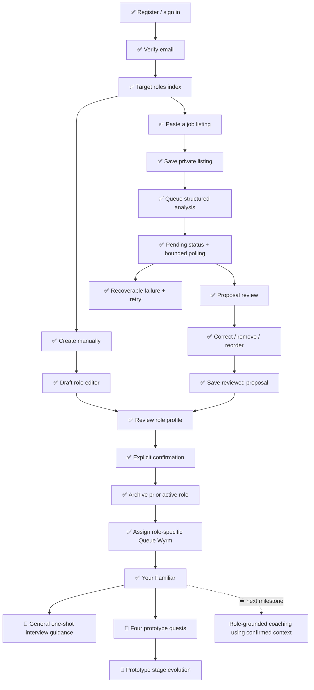

<!--
PLANNING-ASSET-ID: RF-CURRENT-FUNCTIONALITY-WIREFRAME
SNAPSHOT-DATE: 2026-08-03
VERSION: v1
STATUS: CURRENT
REPOSITORY-REVISION: e20f76a
SUPERSEDES: none
SUPERSEDED-BY: none
LAST-REVIEWED: 2026-08-03T06:44:51-04:00

FUTURE EDITOR NOTE:
Do not silently modernize this snapshot. Create a new date-stamped version,
mark this file SUPERSEDED, and update docs/planning/README.md.
-->

# Role Familiar current-functionality wireframe

**Snapshot:** August 3, 2026 · **Version:** v1 · **Status:** CURRENT  
**Repository revision inspected:** `e20f76a`

## Reading key

| Mark | Meaning                                                                         |
| ---- | ------------------------------------------------------------------------------- |
| ✅   | Working application flow backed by routes, domain behavior, and automated tests |
| 🧪   | Working prototype with intentionally temporary product rules                    |
| 🧱   | Foundation or placeholder; not yet a meaningful product workflow                |
| ➡️   | Recommended next implementation step                                            |
| ⛔   | Explicitly deferred from the current product                                    |

“Working” means the behavior exists in the inspected repository and is covered by automated tests where applicable. It does not claim a fresh visual browser sign-off for every viewport or motion state.

## Application shell

```text
┌──────────────────────────────────────────────────────────────────────────────┐
│ ROLE FAMILIAR · authenticated + email-verified application                  │
├──────────────────────┬───────────────────────────────────────────────────────┤
│ NAVIGATION           │ CURRENT PAGE                                          │
│                      │                                                       │
│ 🧱 Dashboard         │ Selected workflow renders here                        │
│ ✅ Your Familiar     │                                                       │
│ ✅ Target Role       │ Shared shell: breadcrumbs, user menu, responsive nav  │
│ 🧪 Familiar Lab      │                                                       │
│                      │                                                       │
│ ✅ Profile           │                                                       │
│ ✅ Security          │                                                       │
│    • password        │                                                       │
│    • 2FA             │                                                       │
│    • passkeys        │                                                       │
└──────────────────────┴───────────────────────────────────────────────────────┘
```

### Shell recommendation

➡️ Replace the placeholder Dashboard with an active-role launchpad, and hide or clearly gate Familiar Lab outside development environments.

## Primary user journey



## Target Role pages

### 1. Role index

```text
┌ Target roles ─────────────────────────────────────── [Create role] ┐
│ Draft, confirm, and choose the role Queue Wyrm coaches toward.    │
│                                                                  │
│ ┌ Active ─────────────┐ ┌ Archived / draft ────────┐             │
│ │ Role title          │ │ Role title               │             │
│ │ Company             │ │ Company                  │             │
│ │ N responsibilities  │ │ N responsibilities       │             │
│ │ N competencies      │ │ N competencies           │             │
│ │ [Review role]       │ │ [Review role]            │             │
│ └─────────────────────┘ └───────────────────────────┘             │
└──────────────────────────────────────────────────────────────────┘
✅ Lists only the signed-in user's roles and identifies the active role.
➡️ Add explicit status filters when role history becomes large enough to need them.
```

### 2. Creation choice

```text
┌ Create a target role ─────────────────────────────────────────────┐
│ ┌ Paste a job listing ───────┐  ┌ Enter manually ──────────────┐ │
│ │ Private AI proposal        │  │ User-authored draft          │ │
│ │ [Paste a job listing]      │  │ [Create manually]            │ │
│ └────────────────────────────┘  └───────────────────────────────┘ │
└──────────────────────────────────────────────────────────────────┘
✅ Both paths converge on the same reviewed TargetRole aggregate.
```

### 3. Manual composer

```text
┌ Basic role details ───────────────────────────────────────────────┐
│ Title* · Company · Seniority · Summary · Interview · Concern     │
├ Responsibilities (0–20) ─────────────────────────────────────────┤
│ [Content] [Priority] [Move up] [Move down] [Remove]              │
│ [Add responsibility]                                             │
├ Competencies (0–30) ─────────────────────────────────────────────┤
│ [Name] [Category] [Priority] [Evidence] [Confidence 1–5]         │
│ [Move up] [Move down] [Remove]                                   │
│ [Add competency]                                                  │
├──────────────────────────────────────────────────────────────────┤
│ [Save draft / Save changes]                                      │
└──────────────────────────────────────────────────────────────────┘
✅ Keyboard-safe ordering, nested errors, focus recovery, empty-row cleanup,
   controlled child IDs, unsaved-change warning, and server-owned sort order.
➡️ Add browser-level regression coverage for 320 px layout and keyboard focus.
```

### 4. Job-listing entry and asynchronous states

```text
┌ Paste a job listing ────────────────────────┬ Queue Wyrm ─────────┐
│ [Private listing text, 100–50,000 chars]    │ listening / idle    │
│ Optional known context:                     │ transient overlay   │
│ • company correction                        │                     │
│ • interview date                            │                     │
│ • biggest concern                           │                     │
│ [Analyze listing]                           │                     │
└─────────────────────────────────────────────┴─────────────────────┘

     request accepted
            │
            ▼
┌ Pending ──────────────────────────────────────────────────────────┐
│ Thinking overlay · status announcement · manual refresh          │
│ 2.5 s Inertia polling; stops on result and while page is hidden  │
└──────────────────────────────────────────────────────────────────┘
       │ completed                         │ failed
       ▼                                   ▼
┌ Review proposal ───────────────┐  ┌ Recoverable failure ─────────┐
│ evidence + confidence visible  │  │ sanitized message            │
│ assumptions + ambiguities      │  │ [Retry analysis]             │
│ user corrections authoritative│  │ old attempt retained         │
└────────────────────────────────┘  └───────────────────────────────┘

✅ Structured Laravel AI SDK agent, queued execution, stale-result protection,
   duplicate in-flight prevention, bounded retries, and private raw listing.
➡️ Add queue observability and staging smoke checks without logging source text.
```

### 5. Analysis review

```text
┌ Review and correct the role proposal ─────────────────────────────┐
│ Basics: title · company · seniority · summary                     │
├ Responsibilities ─────────────────────────────────────────────────┤
│ editable content · priority · evidence · confidence · source     │
│ keyboard move/remove/add controls                                 │
├ Competencies + technologies ──────────────────────────────────────┤
│ editable name/category/priority · evidence · confidence · source │
│ user confidence · keyboard move/remove/add controls               │
├ Interview-focus suggestions ──────────────────────────────────────┤
│ framed as preparation suggestions, not predicted questions       │
├ Ambiguities ──────────────────────────────────────────────────────┤
│ answer / not relevant / unresolved                               │
├ Assumptions ──────────────────────────────────────────────────────┤
│ accept / correct / remove                                         │
├───────────────────────────────────────────────────────────────────┤
│ [Save review corrections]                                        │
│ [ ] I reviewed visible uncertainty                               │
│ [Confirm and make active]                                         │
└───────────────────────────────────────────────────────────────────┘
✅ Original analysis remains append-oriented; reviewed role data is authoritative.
➡️ Add an optional change summary before confirmation for very large proposals.
```

### 6. Confirmed role and lifecycle

```text
┌ Confirmed role ────────────────────────────────────────────────────┐
│ Active / archived state · title · company · summary               │
│ Responsibilities · competencies · source evidence                 │
│ Seniority · interview date · biggest concern                      │
│                                                                   │
│ [Edit] [Confirm/make active] [Archive] [Restore/make active]      │
│ [Delete non-active role to recoverable soft-deleted storage]      │
└───────────────────────────────────────────────────────────────────┘
✅ At most one active confirmed role; switching archives rather than overwrites.
✅ Confirmed roles remain editable and keep their own familiar history.
➡️ Improve historical-role navigation before adding richer longitudinal data.
```

## Your Familiar page

```text
┌ Queue Wyrm · Stage 1/2/3 · prototype quest progress ──────────────┐
│ ┌ Confirmed role context ───────────────────────────────────────┐ │
│ │ title · company · interview date · edit link                 │ │
│ │ top responsibilities · competencies · unresolved ambiguity  │ │
│ │ deterministic acknowledgement                              │ │
│ └──────────────────────────────────────────────────────────────┘ │
│                                                                  │
│ ┌ Animated Queue Wyrm ───────┐  ┌ Ask your familiar ──────────┐ │
│ │ idle / listening / thinking│  │ one short question          │ │
│ │ celebration / evolution    │  │ concise general AI response │ │
│ └────────────────────────────┘  │ optional quest suggestion   │ │
│                                 └───────────────────────────────┘ │
│ ┌ Prototype quests ─────────────────────────────────────────────┐ │
│ │ behavioral story · STAR · company research · technical review│ │
│ └───────────────────────────────────────────────────────────────┘ │
└──────────────────────────────────────────────────────────────────┘
✅ Familiar and progression are isolated per target role.
✅ Displayed role context comes from confirmed data, never the raw analysis.
🧪 Guidance is general and does not yet receive confirmed role context.
🧪 Quest thresholds are temporary: 2 quests → Attuned; all 4 → Interview-ready.
➡️ Next milestone: pass the controlled ConfirmedRoleContext to a dedicated,
   role-grounded coaching agent without granting it progression authority.
```

## Familiar Lab

```text
┌ Familiar Interaction Lab · development prototype ────────────────┐
│ stage selector · idle/evolution preview · overlays               │
│ pause · playback speed · reduced-motion behavior · quest icons   │
│ no persisted progression · no AI behavior                        │
└──────────────────────────────────────────────────────────────────┘
🧪 Useful asset/debug surface, currently visible in authenticated navigation.
➡️ Gate to local/development environments or remove it from production nav.
```

## Explicitly absent

⛔ Familiar matching or additional species  
⛔ Baseline assessment  
⛔ Persistent practice sessions or chat memory  
⛔ STAR story library  
⛔ Readiness score or AI-controlled progression  
⛔ Mock interviews  
⛔ Runtime PixelLab calls

These are not broken links in the wireframe; they are intentionally outside the current application contract.
