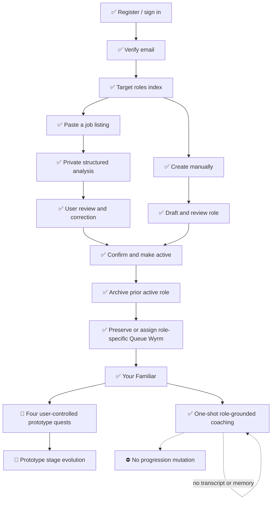

<!--
PLANNING-ASSET-ID: RF-CURRENT-FUNCTIONALITY-WIREFRAME
SNAPSHOT-DATE: 2026-08-03
VERSION: v2
STATUS: CURRENT
REPOSITORY-REVISION: f50ed6c59c1931c5a3c2327b3ede204509fa80f2
SUPERSEDES: 2026-08-03-current-functionality-wireframe-v1.md
SUPERSEDED-BY: none
LAST-REVIEWED: 2026-08-03T09:56:34-04:00

FUTURE EDITOR NOTE:
Do not silently modernize this snapshot. Create a new date-stamped version,
mark this file SUPERSEDED, and update docs/planning/README.md.
-->

# Role Familiar current-functionality wireframe

**Snapshot:** August 3, 2026 · **Version:** v2 · **Status:** CURRENT

**Repository revision inspected:** `f50ed6c59c1931c5a3c2327b3ede204509fa80f2`, including the audited role-grounded coaching working-tree implementation

## Reading key

| Mark | Meaning                                                                         |
| ---- | ------------------------------------------------------------------------------- |
| ✅   | Working application flow backed by routes, domain behavior, and automated tests |
| 🧪   | Working prototype with intentionally temporary product rules                    |
| 🧱   | Foundation or placeholder; not yet a meaningful product workflow                |
| ➡️   | Recommended next implementation step                                            |
| ⛔   | Explicitly deferred from the current product                                    |

“Working” means the behavior exists in the inspected repository and is covered by automated tests where applicable. It does not claim real assistive-technology sign-off for every browser, viewport, or motion state.

## Application shell

```text
┌──────────────────────────────────────────────────────────────────────────────┐
│ ROLE FAMILIAR · authenticated + email-verified application                  │
├──────────────────────┬───────────────────────────────────────────────────────┤
│ NAVIGATION           │ CURRENT PAGE                                          │
│                      │                                                       │
│ 🧱 Dashboard         │ Selected workflow renders here                        │
│ ✅ Your Familiar     │                                                       │
│ ✅ Target Role       │ Shared shell: breadcrumbs, user menu, responsive nav  │
│ 🧪 Familiar Lab      │                                                       │
│                      │                                                       │
│ ✅ Profile           │                                                       │
│ ✅ Security          │                                                       │
└──────────────────────┴───────────────────────────────────────────────────────┘
```

➡️ Replace the placeholder Dashboard with an active-role launchpad, and gate Familiar Lab outside development environments.

## Primary user journey



## Target Role pages

### 1. Role index and creation

```text
┌ Target roles ─────────────────────────────────────── [Create role] ┐
│ ┌ Active ─────────────┐ ┌ Archived / draft ────────┐             │
│ │ title · company     │ │ title · company          │             │
│ │ confirmed themes    │ │ preserved history        │             │
│ │ [Review role]       │ │ [Review role]            │             │
│ └─────────────────────┘ └───────────────────────────┘             │
└──────────────────────────────────────────────────────────────────┘

                  ┌ Create a target role ─────────────┐
                  │ [Paste a private job listing]     │
                  │ [Enter a role manually]           │
                  └───────────────────────────────────┘
```

✅ Only the signed-in user's roles are listed. Both creation paths converge on the same reviewed TargetRole aggregate.

### 2. Manual composer

```text
┌ Basic role details ───────────────────────────────────────────────┐
│ Title* · Company · Seniority · Summary · Interview · Concern     │
├ Responsibilities (0–20) ─────────────────────────────────────────┤
│ content · priority · move · remove · add                         │
├ Competencies (0–30) ─────────────────────────────────────────────┤
│ name · category · priority · confidence · move · remove · add    │
├──────────────────────────────────────────────────────────────────┤
│ [Save draft / Save changes]                                      │
└──────────────────────────────────────────────────────────────────┘
```

✅ Nested validation, controlled child IDs, keyboard-safe ordering, focus recovery, cleanup, and unsaved-change warning remain implemented.

### 3. Job-listing analysis and review

```text
┌ Paste a job listing ────────────────────────┬ Queue Wyrm ─────────┐
│ private listing text · optional known data  │ listening / idle    │
│ [Analyze listing]                           │ transient overlay   │
└─────────────────────────────────────────────┴─────────────────────┘
                   │
                   ▼
┌ Pending ──────────────────────────────────────────────────────────┐
│ thinking · status announcement · bounded polling                 │
└──────────────────────────────────────────────────────────────────┘
       │ completed                         │ failed
       ▼                                   ▼
┌ Review proposal ───────────────┐  ┌ Recoverable failure ─────────┐
│ evidence + uncertainty visible │  │ sanitized message            │
│ user corrections authoritative│  │ [Retry analysis]             │
└────────────────────────────────┘  └───────────────────────────────┘
```

✅ The private original listing supports analysis and review. It is not passed to role-grounded coaching.

### 4. Confirmation and lifecycle

```text
┌ Confirmed role ───────────────────────────────────────────────────┐
│ active / archived · title · company · summary                    │
│ responsibilities · competencies · reviewed uncertainty           │
│ [Edit] [Confirm] [Archive] [Restore] [Delete non-active role]    │
└──────────────────────────────────────────────────────────────────┘
```

✅ At most one confirmed role is active. Switching archives rather than overwrites, and each role retains its own familiar history.

## Your Familiar page

```text
┌ Queue Wyrm · prototype stage and quest progress ─────────────────┐
│ ┌ Confirmed active role ───────────────────────────────────────┐ │
│ │ title · optional company · role lifecycle · edit link       │ │
│ └──────────────────────────────────────────────────────────────┘ │
│                              │                                   │
│                              ▼                                   │
│ ┌ Controlled ConfirmedRoleContext ─────────────────────────────┐ │
│ │ title · company · seniority · summary                        │ │
│ │ confirmed responsibilities · confirmed competencies         │ │
│ │ technologies · reviewed focus areas · unresolved ambiguity   │ │
│ └──────────────────────────────────────────────────────────────┘ │
│                              │                                   │
│                              ▼                                   │
│                  One current user question                       │
│                              │                                   │
│                              ▼                                   │
│              Role-grounded coaching agent                        │
│                    no tools · no browsing                        │
│                              │                                   │
│                              ▼                                   │
│ ┌ Animated Queue Wyrm ───────┐  ┌ Structured answer ──────────┐ │
│ │ idle / listening / thinking│  │ Main coaching guidance      │ │
│ │ response / error recovery  │  │ Role connections            │ │
│ │ controlled reaction enum   │  │ Uncertainties               │ │
│ └────────────────────────────┘  │ Optional user-controlled     │ │
│                                 │ next action                  │ │
│                                 └──────────────────────────────┘ │
│ ┌ Prototype quests ─────────────────────────────────────────────┐ │
│ │ separate user-controlled completion and prototype evolution  │ │
│ └───────────────────────────────────────────────────────────────┘ │
└──────────────────────────────────────────────────────────────────┘
```

### Coaching data boundary

```text
SERVER-RESOLVED INPUT

Authenticated + verified user
        │
        ▼
Active confirmed TargetRole ───── rejects archived / soft-deleted / other-user roles
        │
        ▼
Owned role familiar ───────────── rejects another user's familiar
        │
        ▼
ConfirmedRoleContext
        +
Current validated question
        │
        ▼
RoleGroundedCoach

NOT PASSED
× original job-listing text
× raw analysis output or attempts
× evidence or assumptions
× provider or prompt metadata
× archived-role context
× another user's role or familiar
× prior questions or answers
```

### Response and interaction states

```text
Idle
  │ submit one concise question
  ▼
Listening / Thinking
  │ input retained · submit disabled · duplicate request blocked
  ├──────── provider / schema failure ───────► Recoverable error
  │                                            announced to AT
  │                                            question remains editable
  ▼
Structured response
  • bounded main answer
  • 0–3 role connections to reviewed confirmed themes
  • 0–3 uncertainties
  • optional server-owned next-action type and label
  • controlled Queue Wyrm reaction
  │
  └──────── ask another question ─────────────► replaces local response
```

- ✅ The grounding indicator explains that Queue Wyrm answers using the active confirmed role.
- ✅ The response never presents role connections as citations to the original listing.
- ✅ No conversation history or AI transcript is persisted or displayed.
- ✅ A successful or failed AI response does not create or complete quests, award progress, change stage, trigger evolution, score readiness, or modify role data.
- ✅ Suggested next actions and optional existing quest suggestions remain presentation-only and user-controlled.
- ✅ Pending, error, and response announcements; keyboard submit; predictable focus; narrow responsive layout; and reduced-motion behavior remain present.

🧪 Quest names, thresholds, stage labels, celebration, and evolution remain prototype presentation and are not scientifically validated readiness levels.

## Familiar Lab

```text
┌ Familiar Interaction Lab · development prototype ────────────────┐
│ stage · animation · overlay · playback · reduced-motion preview  │
│ no persisted lab progression · no AI behavior                    │
└──────────────────────────────────────────────────────────────────┘
```

🧪 This remains an asset/debug surface and should be gated outside development.

## Recommended next milestone

```text
➡️ Separate persistent bounded practice-session contract

Define before implementation:
• explicit session ownership and authorization inheritance
• bounded start/end and AI context
• retained user artifacts and user review
• deletion and retention policy
• completion evidence, if any
• a prohibition on automatic scores, readiness, quests, or evolution unless
  separately approved
```

This wireframe does not implement a practice session or authorize persistent chat history.

## Explicitly absent

- ⛔ Persistent practice sessions or conversation history
- ⛔ STAR story persistence
- ⛔ Readiness scores or hiring predictions
- ⛔ Mock interviews
- ⛔ Global competency tracking
- ⛔ AI-created or AI-completed quests
- ⛔ Familiar matching or additional species
- ⛔ Application tracking, outreach charts, voice, video, or runtime PixelLab calls

These are intentionally outside the current application contract, not broken links in the wireframe.
